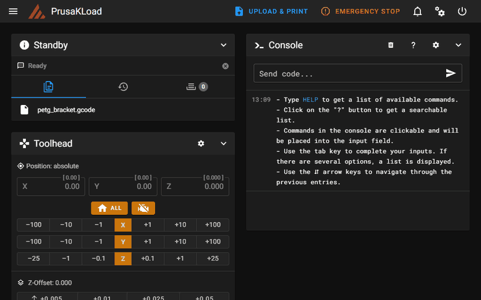
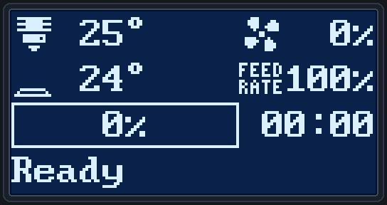
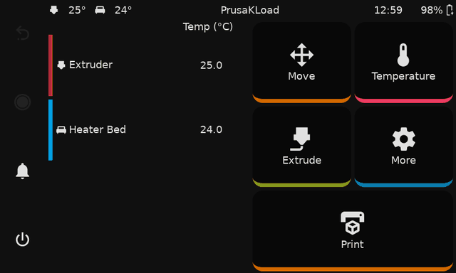
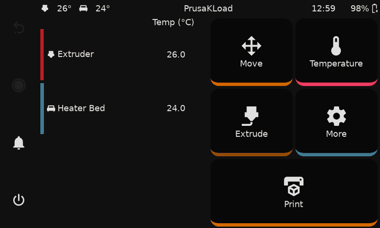

<p align="center">
  
</p>

<p align="center">
  <a href="https://github.com/weegeeday/PrusaKLoad/actions/workflows/ci.yml">
    
  </a>
</p>

PrusaKLoad is a Klipper plugin that brings Prusa MK4S-style filament handling to any Klipper printer with a filament sensor. Push filament into the sensor and the printer asks what material you inserted, heats the hotend, loads and purges, and asks if the color is clear. It saves the loaded material across restarts and checks incoming G-code files before a print starts so you do not accidentally print PETG on a PLA spool.

Dialogs use Klipper's native `action:prompt_*` commands, so they work in Mainsail, Fluidd, and KlipperScreen without extra front-end plugins. Physical Klipper LCDs (`[display]` and `[menu]`) are supported through an optional menu config and `M117` status updates.

## What it looks like

<table>
  <tr>
    <td width="50%" valign="top">
      <strong>Mainsail and Fluidd</strong><br>
      Native Klipper prompt dialogs open over the web dashboard for material selection, purge confirmation, and mismatch warnings.<br><br>
      
    </td>
    <td width="50%" valign="top">
      <strong>Physical Klipper LCD</strong><br>
      <code>prusa_kload_menu.cfg</code> adds context-sensitive menus under <code>PrusaKLoad</code> alongside <code>M117</code> status prompts.<br><br>
      
    </td>
  </tr>
  <tr>
    <td width="50%" valign="top">
      <strong>KlipperScreen (Load Flow)</strong><br>
      Inserting filament opens the material picker, heats to the preset temperature, purges, and asks if the color is clear.<br><br>
      
    </td>
    <td width="50%" valign="top">
      <strong>KlipperScreen (Material Mismatch)</strong><br>
      Starting a print sliced for another material pauses first so you can swap spools, force continue, or cancel.<br><br>
      
    </td>
  </tr>
</table>

## Quick start

1. Clone the repo on your Klipper host:

   ```bash
   cd ~
   git clone https://github.com/weegeeday/PrusaKLoad.git
   ```

2. Run the installer with `--copy-configs` to symlink the Python modules into Klipper and copy the starter config files into `~/printer_data/config`:

   ```bash
   cd ~/PrusaKLoad
   chmod +x install.sh
   ./install.sh --copy-configs
   ```

3. Include the config in `printer.cfg`:

   ```ini
   [include prusa_kload.cfg]
   [include prusa_kload_menu.cfg]  # Optional, only for physical Klipper LCDs
   ```

4. Open `prusa_kload.cfg` and point `filament_sensor:` at your existing `[filament_switch_sensor]` or `[filament_motion_sensor]` (or replace it with a direct `switch_pin:`). Adjust `load_distance`, `purge_distance`, and `unload_distance` for your extruder, then run `FIRMWARE_RESTART`.

To keep PrusaKLoad updated through Mainsail or Fluidd, copy the commented `[update_manager prusa_kload]` block from the bottom of `prusa_kload.cfg` into `moonraker.conf`.

## How it works

### Inserting filament

When the printer is idle and no material is recorded, pushing filament into the sensor opens a material picker after the debounce delay. Pick one of the 10 built-in presets (PLA, PETG, ASA, ABS, PC, TPU, PA, HIPS, PVB, FLEX) or any custom material you defined. PrusaKLoad heats the hotend, feeds and purges, then asks if the color is clear. Choose `Yes (Color Clear)` to save the material to `~/printer_data/config/.prusa_kload_state.json` and cool down, `Purge More` to push another short length, or `Retry` to repeat the load.

### Unloading and swapping

Run `PRUSA_KLOAD_UNLOAD` (or pick `Unload Filament` from the LCD menu) to heat to the loaded material's unload temperature, run the ramming and cooling strokes, and retract. Once the filament leaves the sensor, PrusaKLoad clears the stored material and cools down. Pulling filament out manually while idle also clears the stored material by default.

If you want to go straight from one spool to another, run `PRUSA_KLOAD_SWAP` (optionally with `MATERIAL=PETG`). It unloads the current spool, waits for you to insert the next one, and runs the load flow automatically.

### Pre-print mismatch check

PrusaKLoad wraps `SDCARD_PRINT_FILE` and inspects the first and last 64 KB of the G-code file for slicer filament headers from PrusaSlicer, OrcaSlicer, SuperSlicer, Bambu Studio, and Cura. Aliases like `PLA+`, `PLA-CF`, and `SILK PLA` match `PLA` automatically. If the file calls for a different material (or no material is recorded as loaded), PrusaKLoad holds the print and asks whether to swap filament, force continue, or cancel.

If your slicer passes the material into a `PRINT_START` macro instead, you can call `PRUSA_KLOAD_CHECK MATERIAL={MATERIAL}` inside `PRINT_START`.

## Documentation

Full reference guides live on the [PrusaKLoad Wiki](https://github.com/weegeeday/PrusaKLoad/wiki):

- [Installation](https://github.com/weegeeday/PrusaKLoad/wiki/Installation) covers installer flags, Moonraker `update_manager`, and uninstalling.
- [Configuration](https://github.com/weegeeday/PrusaKLoad/wiki/Configuration) documents every `[prusa_kload]` option, parking coordinates, and G-code hooks.
- [Materials and Slicers](https://github.com/weegeeday/PrusaKLoad/wiki/Materials-and-Slicers) lists all built-in temperatures, custom `[prusa_kload_material]` sections, aliases, and `PRINT_START` integration.
- [UI and LCD Setup](https://github.com/weegeeday/PrusaKLoad/wiki/UI-and-LCD-Setup) explains `action:prompt_*` dialogs and customizing `prusa_kload_menu.cfg`.
- [G-code Commands](https://github.com/weegeeday/PrusaKLoad/wiki/GCode-Commands) covers every `PRUSA_KLOAD_*` command, `printer.prusa_kload` status fields, and the JSON state file.
- [Troubleshooting](https://github.com/weegeeday/PrusaKLoad/wiki/Troubleshooting) helps with sensor polarity, debounce timing, `max_extrude_only_distance`, and mismatch checks.

Run the offline test suite locally with `pytest -v`.
